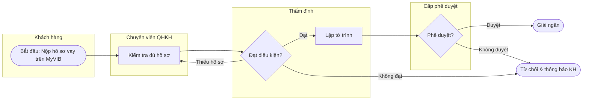
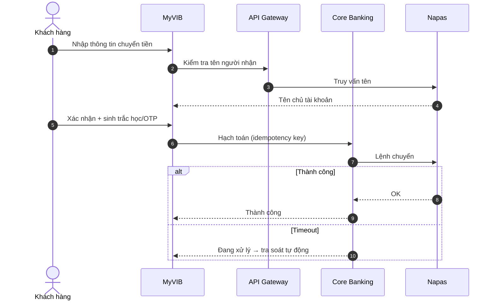

# Vẽ quy trình nghiệp vụ ngân hàng

## Chọn loại sơ đồ
| Mục đích | Loại Mermaid |
|---|---|
| Luồng công việc giữa các phòng ban / vai trò | `flowchart LR` với `subgraph` làm swimlane |
| Tương tác giữa hệ thống (App → API Gateway → Core → Napas) | `sequenceDiagram` |
| Vòng đời trạng thái (hồ sơ vay, thẻ, giao dịch) | `stateDiagram-v2` |
| Cấu trúc dữ liệu | `erDiagram` |
| Lộ trình dự án | `gantt` |

## Quy trình
1. Liệt kê: actor/vai trò, hệ thống, sự kiện bắt đầu, sự kiện kết thúc, điểm quyết định, SLA.
2. Vẽ **As-Is** trước (nếu có), đánh dấu điểm đau bằng `:::pain` (nút màu đỏ) và ghi chú lý do.
3. Vẽ **To-Be**, chỉ rõ bước được tự động hóa / loại bỏ.
4. Bổ sung bảng mô tả bước: `Bước | Vai trò | Hệ thống | Mô tả | Đầu vào | Đầu ra | SLA | Kiểm soát`.
5. Tóm tắt khác biệt As-Is vs To-Be và lợi ích định lượng (giảm số bước, giảm thời gian xử lý…).

## Nguyên tắc
- Mỗi điểm quyết định phải có **đủ nhánh** (Đạt / Không đạt / Cần bổ sung hồ sơ).
- Luôn thể hiện: maker–checker, nhánh từ chối, nhánh timeout/lỗi hệ thống, điểm sàng lọc AML nếu có.
- Nhãn tiếng Việt ngắn gọn, đặt trong dấu ngoặc kép để tránh lỗi ký tự: `A["Kiểm tra CIC"]`.
- Không đưa tên người thật, chỉ dùng vai trò.

## Mẫu swimlane

## Mẫu sequence (chuyển tiền nhanh)

